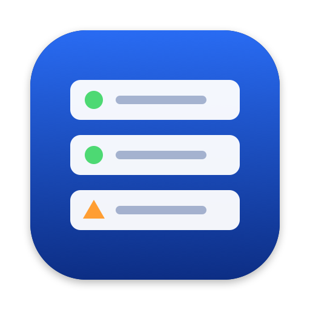
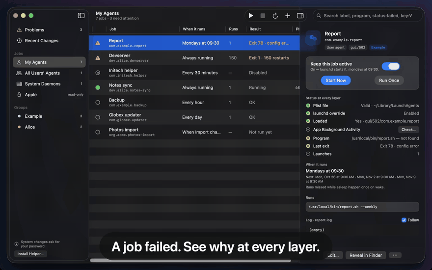
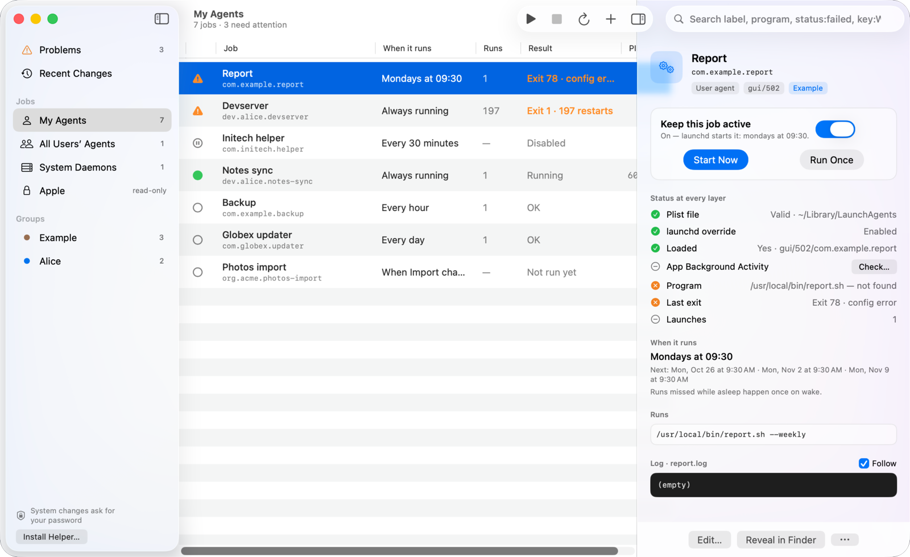
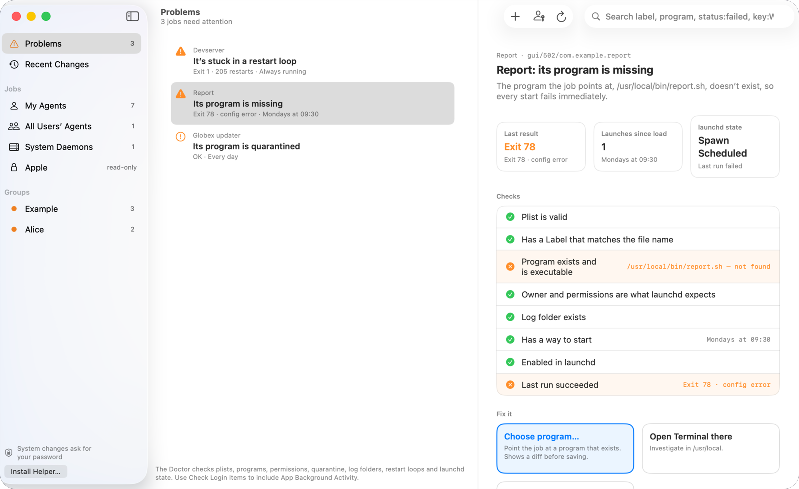
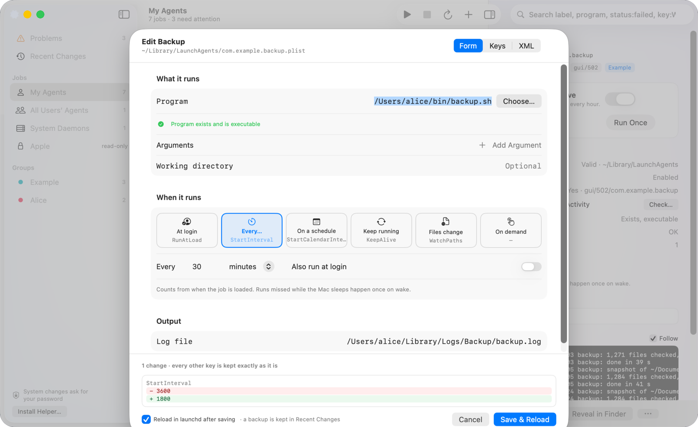
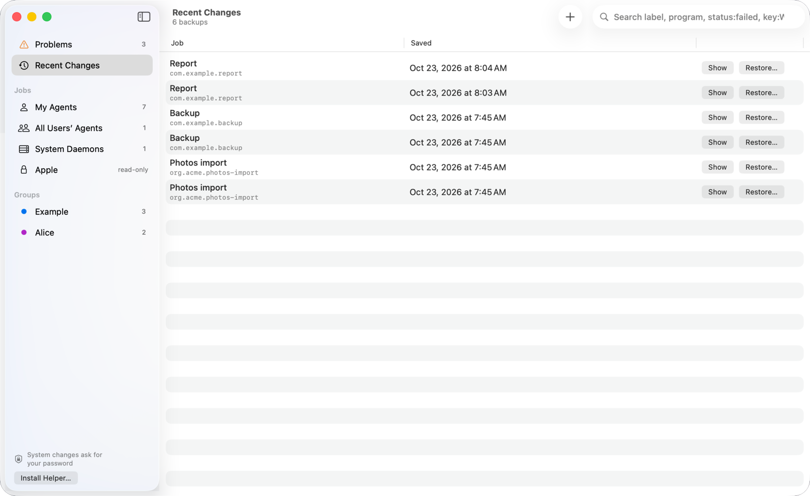
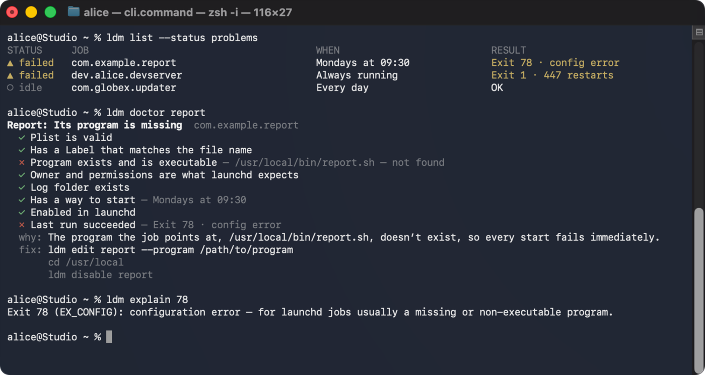

<p align="center">
  
</p>

<h1 align="center">LD Manager</h1>

<p align="center">
  <b>Know what runs on your Mac, and why it doesn’t.</b><br>
  A free, open-source, native macOS app and CLI for LaunchAgents and LaunchDaemons.
</p>

<p align="center">
  <a href="https://github.com/roeehrl/ldmanager/actions/workflows/ci.yml"></a>
  <a href="LICENSE"></a>
  
  
  
</p>

<p align="center">
  <a href="#what-it-does">What it does</a> ·
  <a href="#install">Install</a> ·
  <a href="#the-ldm-command">CLI</a> ·
  <a href="#why-not-launchcontrol-lingon-or-launchctl">Why not…?</a> ·
  <a href="#faq">FAQ</a> ·
  <a href="#contributing">Contributing</a>
</p>

<p align="center">
  
  <br><sub>A job fails with exit 78; LD Manager shows why, the Doctor offers the fix, the editor shows the diff, and the job runs. All data in these images is made up.</sub>
</p>

`launchctl` tells you `Bootstrap failed: 5: Input/output error` and leaves you to guess.
LD Manager reads every layer launchd has — the plist on disk, whether it's loaded, the
enable/disable override, the Login Items switch, the PID, the launch count and the last
exit code — and tells you in plain words what's wrong and how to fix it.

## What it does

<picture>
  <source media="(prefers-color-scheme: dark)" srcset="docs/assets/hero-dark.png">
  
</picture>

- **See every job and its real state.** Your agents, agents for all users, system
  daemons and (read-only) Apple's own — each with one status joined from every layer:
  running, waiting, failed, disabled, off in Login Items, not loaded or invalid.
- **Find out why it fails.** The Doctor checks for invalid plists, missing Labels,
  missing, non-executable or quarantined programs, an unexpanded `~`, wrong ownership or
  permissions, missing log folders, restart loops, jobs enabled but not loaded, and
  failed runs — and offers a fix for each.
- **Read schedules and exit codes like a person.** `StartCalendarInterval {Weekday 1,
  Hour 9, Minute 30}` is *Mondays at 09:30*, with the next runs. `78` is *EX_CONFIG:
  usually a missing or non-executable program*; `-15` is *killed by SIGTERM*.
- **Edit without losing a key.** A plain-language form, a Keys view and raw XML. Changes
  are applied to the file's own dictionary, so keys the form doesn't know survive. Every
  save shows a diff first and keeps a backup you can restore from *Recent Changes*.
- **Start, stop, enable, disable, load, unload** — with a switch, a menu-bar extra for
  pinned jobs, or `ldm`.
- **Script it.** `ldm` is the same core as a CLI, with `--json`, `--dry-run` that prints
  the exact `launchctl` commands, and documented exit codes.

<table>
  <tr>
    <td width="50%"><picture><source media="(prefers-color-scheme: dark)" srcset="docs/assets/doctor-dark.png"></picture><br><b>The Doctor</b> explains the failure and offers the fix.</td>
    <td width="50%"><picture><source media="(prefers-color-scheme: dark)" srcset="docs/assets/editor-dark.png"></picture><br><b>Lossless editing</b>: see the diff before you save.</td>
  </tr>
  <tr>
    <td width="50%"><picture><source media="(prefers-color-scheme: dark)" srcset="docs/assets/recent-dark.png"></picture><br><b>Recent Changes</b>: every save keeps a backup.</td>
    <td width="50%"><br><b><code>ldm</code></b>: the same Doctor in your terminal.</td>
  </tr>
</table>

Requires macOS 26 or later.

## Install

A signed and notarized download and a Homebrew cask come with the first release. Until
then, build it from source — it takes about a minute.

### From source

You need Xcode 26 and [XcodeGen](https://github.com/yonaskolb/XcodeGen) (`brew install xcodegen`).

```bash
scripts/build-app.sh
```

This produces `build/LD Manager.app` with `ldm` bundled in `Contents/Helpers`. In the
app, **Settings → Command-line tool** links it into `/usr/local/bin`.

The script signs with your first *Developer ID Application* or *Apple Development*
certificate (hardened runtime, ready to notarize), or with `SIGN_IDENTITY` if set.
`SIGN_IDENTITY=-` signs ad-hoc; everything works except the privileged helper.

The CLI also builds on its own:

```bash
swift build -c release --product ldm
```

Run the tests with `swift test`.

### Quick start with `ldm`

```bash
ldm list --status problems     # jobs that need attention
ldm doctor report              # why "report" fails, and how to fix it
ldm explain 78                 # what an exit code means
ldm new backup --every 1h -- ~/bin/backup.sh
ldm logs backup -f
```

## The `ldm` command

```text
ldm list [--status failed|running|disabled|problems] [--scope user|allUsers|system] [--json|--plain]
ldm show <job> [--json] [--background]
ldm doctor [<job>] [--json] [--background]
ldm start|stop|restart|load|unload|enable|disable <job> [--dry-run]
ldm logs <job> [-n 40] [-f]
ldm new <name> (--every 15m | --cron "30 9 * * 1" | --keep-alive | --watch <path>) [--log <file>] -- <program> [args…]
ldm edit <job> [--program <path>] [--every …] [--log <file>] [--dry-run]
ldm remove <job> --confirm <label>
ldm explain <code>
ldm helper
```

A job can be named by its full label, its last label component, its file name, or
any unique part of its label. `--dry-run` prints the exact `launchctl` commands
instead of running them. Colors are off when output isn't a terminal or `NO_COLOR`
is set.

`--background` re-reads Login Items › App Background Activity. macOS asks for your
password each time, so without the flag `ldm` uses the last result it read.

| Exit code | Meaning |
|---|---|
| 0 | Success |
| 1 | General error |
| 2 | Usage error, or the name matches several jobs |
| 3 | No such job |
| 4 | Administrator authorization needed or cancelled |
| 5 | launchd rejected the operation |
| 6 | `doctor` found problems |

## Why not LaunchControl, Lingon or launchctl?

- **LaunchControl** is the most complete launchd tool and worth its price if you live in
  launchd. LD Manager is free and open source, explains things in plainer language, and
  has a scriptable CLI with JSON output. LaunchControl has more expert features today.
- **Lingon** makes creating jobs easy but shows less of why one isn't running.
  LD Manager is built around that question.
- **KnockKnock / BlockBlock** show what persists on your Mac and alert on new items, for
  security. They don't edit, start or diagnose jobs. Use them together.
- **System Settings › Login Items** only has on/off switches for registered items: no
  schedules, logs, exit codes or editing.
- **`launchctl` and a text editor** work if you know launchd well. LD Manager translates
  the errors, shows the exact commands (`--dry-run`) and keeps a backup of every edit.
- **`brew services`** only manages Homebrew formulae.

## FAQ

**Is it safe to edit system jobs with it?**
Every save shows a diff and keeps a backup first; Apple's jobs on the sealed system volume
are read-only; changes to system daemons and `/Library` go through macOS's administrator
prompt or the optional helper you approve once.

**Does it send anything anywhere?**
No. It makes no network connections and has no analytics. It reads launchd's state with
`launchctl` and your plist files on disk.

**Why does it need macOS 26?**
It uses the current SwiftUI and the Login Items (Background Task Management) behaviour of
recent macOS. Supporting older versions is open for discussion — see Contributing.

**Why not the Mac App Store?**
Sandboxed apps can't drive `launchctl` or read other apps' launch jobs.

**What does "LD" stand for?**
launchd.

## How it works

There is no public API for launchd state, so LD Manager reads it the way an
administrator would: `launchctl print <domain>` for each domain's services,
`launchctl print-disabled` for overrides, `launchctl print <domain>/<label>` for a
job's details, and the plist files themselves. Apple documents `launchctl print`'s
output as not being an API, so every parser ignores lines it doesn't recognise.

The **App Background Activity** switches (called *Allow in the Background* on earlier macOS versions) live in Background Task Management, a
database only root can read. There is no public API for it, so LD Manager reads it
with `sfltool dumpbtm`, which shows an administrator prompt every time it runs.
Without the helper it is only read when you ask (**Check Login Items…** in the
app, `--background` in the CLI); with the helper it is read silently, and the app
keeps it fresh. The result is cached in `~/Library/Caches/LDManager`. These switches can't be changed programmatically;
the app opens the Login Items pane in System Settings instead.

## The privileged helper

Changing system daemons and files in `/Library` needs root. Without help, every
such action shows macOS's administrator prompt. LD Manager can instead install a
small helper (`SMAppService` daemon, bundled in the app) that you approve once in
**System Settings › General › Login Items › App Background Activity**.

- Nothing is asked at launch. The first time you do something that needs root, LD
  Manager explains the helper and offers **Continue**, **Use Password Instead** or
  **Cancel**. Choosing passwords is remembered; a banner, not a dialog, reminds you.
- On **Continue**, System Settings opens with a small guide beside it. LD Manager
  detects the approval on its own, confirms the helper answers, and finishes what
  you were doing.
- The helper only accepts LD Manager and its bundled `ldm`, verified by code
  signature (same team, specific bundle identifiers). It does a fixed set of things,
  each validated: `launchctl` on the `system` domain, writing or removing plists in
  `/Library/LaunchDaemons` and `/Library/LaunchAgents`, fixing their permissions,
  creating log folders, removing quarantine, and reading Login Items.
- Remove it any time in **Settings › Privileged helper**. `ldm helper` reports
  whether it is reachable. It exits when idle and launchd relaunches it from the
  current app, so updates take effect on their own (`ldm helper --restart` forces it).

Changes go through `launchctl bootstrap`, `bootout`, `enable`, `disable`,
`kickstart` and `kill`. Changes to system daemons, and writes to `/Library`, ask for
an administrator password through macOS.

## Layout

```text
Sources/LDCore   job model, plist reading and lossless editing, launchctl adapter,
                 schedules, exit codes, the Doctor
Sources/ldm      the CLI (Swift Argument Parser)
Sources/LDManagerHelper  the privileged helper (XPC, runs as root)
App/             the SwiftUI app (XcodeGen project.yml, Sources, Resources)
Tests/           unit tests for the parsers, schedules, editing and the Doctor
scripts/         app bundle build script and icon renderer
demo/            the invented demo world and the scripts that make the screenshots
docs/            research notes behind the design; docs/assets has the README images
```

## Contributing

Issues and pull requests are welcome — bug reports with the output of `ldm show <job>
--json` help most. Good places to start are issues labelled
[`good first issue`](https://github.com/roeehrl/ldmanager/labels/good%20first%20issue) and
[`help wanted`](https://github.com/roeehrl/ldmanager/labels/help%20wanted).
See [CONTRIBUTING.md](CONTRIBUTING.md) for the 60-second setup, and
[`demo/`](demo/README.md) for the invented demo world the screenshots come from, so you
never need to touch your own launch jobs to test a change.

## Roadmap

- Notifications when something adds or changes a launch job, and a timeline of upcoming runs.
- A Background Items explorer: owner app, Team ID, orphaned items.
- Shortcuts actions and templates for common jobs.

## License

MIT — see [LICENSE](LICENSE). LaunchControl, Lingon, KnockKnock and BlockBlock are
products of their respective owners; LD Manager is not affiliated with them or with Apple.
